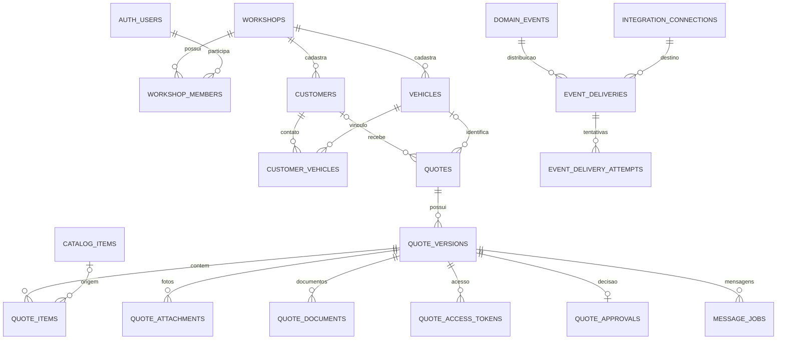

# Banco de dados do sistema automotivo

> Documento historico do escopo de orcamentos (09/09/2026). O modelo atual, com planos, OS, mapa da oficina e portal, esta em [product-v2.md](product-v2.md). As migrations atuais estao em `supabase/migrations/`. O bloqueio de projetos gratuitos foi resolvido e a implantacao remota concluida em 28/09/2026; consulte [o registro do deploy](deployment-2026-09-28.md). A descricao abaixo registra o estado da entrega antiga, nao o estado remoto atual.

Projeto inicial em 09/09/2026. PostgreSQL com Supabase Auth e Storage. Sem API de placa obrigatória.

## O que foi entregue e o que ainda será implementado

- `schema.sql`: DDL de referência com 27 tabelas, índices, chaves estrangeiras compostas, RLS, permissões e proteção de conteúdo publicado.
- `validate.mjs`: testes locais com PostgreSQL em WebAssembly (PGlite), simulando somente identidades/roles mínimas do Supabase.
- Este documento: regras de domínio, contratos de transação, fluxo n8n, ordem de implementação e critérios de aceite.
- Não houve aplicação em banco remoto, criação de contas, configuração de Storage, envio de mensagens ou instalação de n8n.
- Este DDL é a base estrutural. Ainda não existem RPCs de negócio, endpoints, gerador de PDF, workers nem policies de Storage. Não é uma aplicação pronta para produção.
- O SQL foi mantido fora de `supabase/migrations` de propósito: promova-o depois de validar no Supabase de desenvolvimento e implementar os contratos abaixo. Não é idempotente: execute uma vez em banco vazio.

## 1. Escopo

O produto faz: oficina acessa conta, informa veículo/cliente, adiciona itens/fotos, publica orçamento, produz PDF, envia mensagem e recebe aprovação do cliente.

O banco já reserva estrutura para integração n8n, reenvios e lembretes. Não inclui estoque, contabilidade, ordens de serviço completas, fiscal, assinatura SaaS ou agenda de produção: esses domínios entram em migrations próprias quando forem implementados.

## 2. Convenções

| Assunto | Regra |
| --- | --- |
| Identificadores | `uuid`, gerado pelo banco, sem significado comercial |
| Empresa | `workshop_id` em cada registro operacional |
| Datas | `timestamptz`; apresentar no fuso da oficina |
| Dinheiro | Preços e totais em centavos inteiros; quantidades em `numeric(12,3)` |
| Arredondamento | Arredondar cada linha para centavos com decimal exato; somar linhas; aplicar desconto geral em centavos |
| Moeda | BRL nesta versão |
| Telefone | E.164, por exemplo `+5516999999999`; não identifica unicamente uma pessoa |
| Placa | Maiúsculas, sem separadores; antiga ou Mercosul; preenchimento manual permitido |
| JSON | Snapshots versionados e metadados; itens e relacionamentos são tabelas |
| Segredos | Referências a cofre de segredos; nunca tokens abertos nas tabelas de leitura do frontend |
| Exclusão | Cadastros arquivados; propostas publicadas preservadas; política de retenção precisa ser definida |
| SQL | Chaves e constraints usam a oficina além do ID, impedindo vínculos entre empresas |

O frontend deve respeitar limites de valores seguros no JavaScript. Para valores grandes, transportar inteiros como strings/decimal; nunca converter silenciosamente bigint fora da faixa segura em `Number`.

## 3. Relações principais



O desenho simplifica relações: o SQL é a referência exata para todas as FKs.

## 4. Dicionário por grupo

### Oficina e cadastros

| Tabela | O que guarda | Observação |
| --- | --- | --- |
| `workshops` | Nome, contato, fuso, moeda, logo e contador de orçamento | `next_quote_number` é incrementado sob trava |
| `workshop_members` | Relação usuário/oficina, perfil e ativo | Login e senha ficam em `auth.users` |
| `customers` | Nome e telefone, e-mail opcional | Telefone compartilhado é permitido; busca sugere cadastros |
| `vehicles` | Placa, marca, modelo e ano; origem opcional | Não exige fornecedor externo; placa única por oficina |
| `customer_vehicles` | Quem é contato/proprietário/frota do veículo | Não sobrescrever o cliente histórico dos orçamentos |
| `catalog_items` | Serviço ou peça, preço sugerido, unidade e favorito | Um item avulso pode não ter catálogo |
| `file_assets` | Bucket, caminho, tipo, tamanho, hash e situação do upload | Arquivo físico fica no Storage privado |

`customer_vehicles` mantém um vínculo por par cliente/veículo, podendo encerrá-lo. Não é um registro legal nem histórico completo de transferências de propriedade; isso exigiria outra entidade se virar requisito.

Modelo de veículo pode ser informado manualmente. Cadastros de veículo não devem disparar consulta paga implicitamente. Campos `source_provider` e `source_checked_at` permitem uma integração posterior sem mudar as telas.

### Orçamentos

| Tabela | O que guarda | Invariante |
| --- | --- | --- |
| `quotes` | Identidade, número, cliente, veículo, status, versão atual e revisão | Um orçamento atravessa várias versões |
| `quote_versions` | Proposta editável ou publicada, snapshots, condições, valores e validade | `published_at` preenchido congela a linha |
| `quote_items` | Descrição, tipo, unidade, quantidade, preço e total da linha | Copia valores do catálogo; conteúdo publicado não muda |
| `quote_attachments` | Fotos, legendas e visibilidade | Anexos também congelam com a publicação |
| `quote_documents` | PDFs gerados, arquivo e versão do template | Gerar novamente é inserir outro documento |
| `quote_access_tokens` | Hash do segredo de acesso, validade e revogação | Um link aponta para uma versão exata |
| `quote_approvals` | Aprovação ou recusa, texto confirmado, nome e método | Uma decisão final por versão, sem sobrescrita |

Decisão: aprovação integral. Aprovação parcial futura exige modelar seleção de itens ou revisão; não sobrecarregar `payload` com esse significado.

### Mensageria

| Tabela | O que guarda | Invariante |
| --- | --- | --- |
| `whatsapp_connections` | Provedor, conta, número, estado e referência de credencial | Backend determina oficina pelo número conectado |
| `message_jobs` | Intenção de mensagem, destinatário, documento, chave de repetição e estado | O mesmo comando não cria duas tarefas |
| `message_attempts` | Resultado de cada tentativa de enviar | Diferencia falha temporária, permanente e resultado incerto |
| `message_events` | Eventos recebidos do provedor, chave única e processamento | Duplicatas são ignoradas; evento pode chegar antes da resposta de envio |

As regras de janela de atendimento, modelos, consentimento e cobrança precisam ser avaliadas na integração de mensageria. Este esquema não dá autorização automática para mensagens. Se implementar controle de preferência/consentimento por contato, criar tabela específica com origem e data; não inferir a partir de `customers.phone_e164`.

### Automação e operação

| Tabela | O que guarda | Para que existe |
| --- | --- | --- |
| `domain_events` | Fato ocorrido, entidade, revisão, payload mínimo e correlação | Outbox transacional, criada junto da mudança de negócio |
| `integration_connections` | Destino n8n/webhook, habilitado e referência de segredo | Configuração por oficina, sem acoplar o orçamento ao n8n |
| `integration_subscriptions` | Quais eventos cada destino recebe | Conectar só o que o fluxo precisa |
| `event_deliveries` | Uma entrega por evento/destino, estado, tentativas e trava | Retomar distribuição após falha |
| `event_delivery_attempts` | Cada tentativa HTTP do dispatcher | Diagnóstico e histórico de retry |
| `integration_api_keys` | Hash da credencial de entrada, escopos, oficina e revogação | n8n chama a API com acesso restrito |
| `automation_runs` | Workflow/versão, chave idempotente, hash do pedido e resultado | Saber se um comando já foi executado |
| `scheduled_actions` | Lembrete/expiração, vencimento, estado e tentativas | Esperas duráveis e canceláveis |
| `audit_logs` | Ator, ação, entidade, correlação e metadados mínimos | Rastreabilidade de mudanças importantes |

Não duplicar o banco interno do n8n aqui. `external_execution_id` é só referência de diagnóstico. O produto mantém o estado necessário para recomeçar uma automação sem depender do histórico do n8n.

## 5. Rascunho, publicação e novas versões

1. Criar `quotes` e `quote_versions` v1 em transação. A v1 tem `published_at = null`.
2. Autossalvamento edita essa versão e seus itens. `lock_version` evita que uma resposta antiga sobrescreva a edição nova.
3. Publicação valida os dados, recalcula valores e congela a versão preenchendo `published_at`.
4. `quotes.current_version_id` aponta para a versão publicada, `status = awaiting_approval`.
5. PDF, mensagem e token apontam para essa mesma versão.
6. Para corrigir proposta publicada ainda não aprovada, clonar para v2 em rascunho. Enquanto v2 é rascunho, v1 continua sendo a oferta ativa.
7. Ao publicar v2, revogar os links e cancelar os lembretes pendentes de v1. Alterar a versão atual atomicamente.
8. Se v1 tiver sido aprovada durante a edição de v2, a publicação de v2 deve falhar; o usuário cria novo orçamento/aditivo. Não modificar silenciosamente o compromisso aprovado.

Snapshot exemplo de veículo:

```json
{
  "plate": "ABC1D23",
  "brand": "Volkswagen",
  "model": "Gol 1.0",
  "model_year": 2014
}
```

Snapshots de oficina e cliente incluem somente campos que aparecem na proposta. São validados por schema no backend. Para logo/fotos, referenciar objetos imutáveis: novo upload usa novo caminho, nunca sobrescrever o arquivo antigo. O hash e o documento guardam evidência da renderização.

## 6. Estados independentes

`quotes.status`: `draft`, `awaiting_approval`, `approved`, `declined`, `expired`, `cancelled`.

`quote_versions.published_at`: separa rascunho de conteúdo congelado; uma versão congelada não é descongelada ao cancelar o orçamento.

`message_jobs.status`: `pending`, `processing`, `accepted`, `delivered`, `read`, `retry`, `unknown`, `dead`, `cancelled`.

`event_deliveries.status`: `pending`, `processing`, `accepted`, `retry`, `dead`, `cancelled`.

`automation_runs.status`: `pending`, `running`, `succeeded`, `failed`, `cancelled`.

`accepted` em entrega de webhook só confirma recebimento HTTP. Não significa que o workflow terminou. O workflow conclui por callback autenticado ou comando idempotente; execução travada deve ser conciliada/alertada.

Receber uma leitura de WhatsApp não aprova nada. GET da página, robô de preview e download do PDF não geram aprovação. O cliente confirma por POST explícito, e o backend verifica versão atual, token, validade e estado sob trava.

## 7. RPCs de negócio a implementar antes do frontend gravar

O DDL nega gravações diretas do navegador. Para começar, todas as escritas usam endpoints com validação e RPCs transacionais. O backend com credencial administrativa precisa verificar usuário/escopo: essa credencial ignora RLS. Nunca confiar em `workshop_id` que veio do cliente sem conferir vínculo.

| Operação | Validações e gravações na mesma transação |
| --- | --- |
| `create_workshop` | Usuário autenticado; inserir oficina e primeiro owner juntos |
| `manage_member` | Apenas owner/manager autorizado; impedir remover/desativar último owner |
| `create_quote` | Vínculo ativo; incrementar contador sob trava; criar orçamento e v1; idempotência para reenvio do comando |
| `save_quote_draft` | Comparar revisão esperada; travar quote e versão; editar itens/snapshots; incrementar revisão |
| `publish_quote` | Travar quote e versão; impedir publicar aprovado/cancelado; exigir itens, cliente/telefone, veículo/modelo; conferir arquivos prontos; recomputar totais; congelar snapshots; trocar versão atual; revogar versão anterior; outbox + auditoria |
| `record_quote_decision` | Validar hash/expiração/revogação; versão publicada/atual; quote aguardando; inserir decisão; mudar quote; cancelar lembretes; outbox + auditoria |
| `cancel_quote` | Ator autorizado; regras de cancelamento; atualizar quote; revogar links; cancelar pendências; outbox |
| `request_quote_message` | Conferir versão e destino; documento pronto; conexão ativa; chave idempotente; inserir job |
| `request_quote_reminder` | Mesmo teste de versão/validade/aprovação no momento do envio; gerar no máximo um job por lembrete |
| `expire_quote` | Só expirar se ainda aguarda e validade venceu; cancelar pendências; registrar evento |

Usar ordem de travas consistente: quote antes da versão, depois dependências. Se houver deadlock/transient serialization, retry limitado de toda a transação. Nunca segurar uma transação aberta durante chamada HTTP/PDF.

O `CHECK` dos totais valida os valores dentro da versão, mas não agrega automaticamente as linhas: a RPC `publish_quote` precisa calcular `subtotal_cents = sum(line_total_cents)`, conferir desconto e quantidade de itens. A consulta precisa ocorrer depois de adquirir as travas. A proteção SQL congela itens e anexos após publicação.

`lock_version` é somente uma coluna de revisão no DDL: a RPC deve fazer compare-and-swap, devolvendo conflito quando a revisão do cliente estiver atrasada.

Estados, validade e token são revalidados no servidor; `CHECK` não consulta o relógio para expirar registros. O job agendado atualiza o estado, mas a aprovação também testa a hora atual, mesmo se esse job atrasou.

## 8. Contrato de eventos para n8n

Eventos iniciais: `quote.published`, `quote.approved`, `quote.declined`, `quote.cancelled`, `quote.expired`, `quote.document_ready`, `quote.message_delivered`, `quote.message_failed`.

Não emitir automação a cada tecla ou autosave. Nomear fato de negócio, não nome de tabela. A mudança de status e a inserção em `domain_events` ocorrem na MESMA RPC/transação. Fazer duas chamadas REST separadas não é atômico.

Envelope sugerido (IDs abaixo são ilustrativos):

```json
{
  "id": "event-uuid",
  "type": "quote.approved",
  "schema_version": 1,
  "workshop_id": "workshop-uuid",
  "occurred_at": "2026-09-09T15:00:00Z",
  "aggregate": {
    "type": "quote",
    "id": "quote-uuid",
    "version": 8
  },
  "correlation_id": "correlation-uuid",
  "data": {
    "quote_version_id": "version-uuid",
    "approval_id": "approval-uuid"
  }
}
```

`aggregate.version` é a revisão do agregado (`lock_version`), não o número comercial de versão da proposta. `schema_version` descreve o formato do evento. São conceitos diferentes.

Não incluir token de aprovação, chave de API, PDF em base64, CPF, telefone ou conteúdo integral sem necessidade. n8n busca dados estritamente necessários em endpoint autorizado por oficina. Logs de execução do n8n também precisam de retenção e proteção.

### Distribuição

1. Worker consulta eventos elegíveis e assinaturas habilitadas. Por padrão, assinatura nova só recebe eventos a partir de `subscribed_at`; replay histórico é ação explícita.
2. Insere `event_deliveries` com `ON CONFLICT (event_id, connection_id) DO NOTHING`. Um varredor periódico reconcilia eventos sem entrega; não depender só de uma notificação volátil.
3. Worker reserva lote elegível com `FOR UPDATE SKIP LOCKED`, atribui `lease_token` aleatório e `locked_until`, incrementa tentativas e registra início da tentativa em transação curta.
4. Faz POST fora da transação. URL é administrada e validada no backend contra allowlist, IPs privados/loopback e redirecionamentos; `https://` no CHECK não previne SSRF.
5. Grava resultado apenas se ainda possui o mesmo `lease_token`. Não permitir que um worker antigo finalize trabalho reservado por outro.
6. Em erro temporário, aplicar atraso progressivo com jitter, respeitar `Retry-After` e limite. Exemplo: 30s, 2min, 10min, 1h. Erro permanente vai para `dead`.
7. Recuperar leases vencidos, alertar em `dead`, oferecer reprocessamento mantendo a chave original.

Entrega é pelo menos uma vez: n8n pode receber duplicado. Não há promessa de exatamente uma vez em HTTP. Banco garante unicidade do comando, mas chamadas a provedores externos podem ter resultado incerto. Se o provedor aceitou a mensagem e a resposta se perdeu, marcar `unknown` e conciliar antes de reenviar cegamente.

### Exemplo de workflow futuro

```text
Webhook autenticado (quote.approved)
  -> validar envelope
  -> chamar API do SaaS com Idempotency-Key: evento + acao
  -> API verifica chave, escopo e oficina
  -> API registra/reutiliza automation_runs
  -> API cria uma tarefa de notificacao com chave unica
  -> workflow registra conclusao
```

Não fazer `SELECT` para procurar chave e depois `INSERT` sem proteção: usar restrição única e transação. Mesmo `idempotency_key` com `request_hash` diferente deve devolver conflito. Reexecução recupera o resultado anterior ou informa processamento pendente.

Não passar `service_role`/senha do banco para n8n. Armazenar a credencial restrita no gerenciador de credenciais do n8n. A chave enviada ao SaaS é resolvida no backend para a oficina e escopos (`quotes:read`, `messages:request`, por exemplo). O hash fica no banco; a chave original é exibida apenas na emissão e pode ser revogada/rotacionada.

Webhook do n8n deve usar autenticação de cabeçalho/JWT; escolher URL de produção com workflow publicado. Se escolher HMAC, implementar validação do corpo bruto e timestamp explicitamente: Header Auth sozinha não faz essa validação. Proteger contra replay usando ID único e validação temporal adequada às tentativas.

## 9. Lembretes sem dependência de uma execução aberta

Publicar orçamento pode inserir `scheduled_actions` com `due_at` e chave, por exemplo `quote:<version>:reminder:1`. Um cron/worker pega vencidos. O n8n pode orquestrar, mas o prazo e a decisão de cancelar vivem no banco do produto.

Antes de criar/enviar uma mensagem, revalidar versão atual, status e validade. Aprovação/cancelamento cancela ações e jobs ainda pendentes. Uma mensagem já entregue ao provedor não pode ser desfeita por atualizar o banco; aceitar e documentar essa janela de corrida.

## 10. Arquivos e links

- Criar bucket privado; caminho sugerido `<workshop_id>/<asset_id>/<nome-seguro>`.
- Nunca salvar URL assinada com expiração como localização permanente do arquivo; salvar bucket/path.
- Backend gera URLs temporárias após autorização. Página pública acessa só anexos daquela versão com `visible_to_customer = true`.
- Validar conteúdo/MIME/tamanho e impedir sobrescrita do objeto referenciado em proposta publicada.
- Token público deve ter pelo menos 32 bytes aleatórios, codificados em base64url. Guardar SHA-256 no banco.
- Para reenvio do mesmo link pelo worker, manter o token original cifrado em cofre (`secret_ref`) ou emitir novo token controlado. Não é possível reconstruir token a partir do hash.
- Registrar confirmação explícita com texto e nome declarado. `bearer_link` não prova identidade forte. OTP exige integração adicional.
- Acesso público passa pelo backend; não há policy `SELECT true` para `anon`.

## 11. Acesso e auditoria

No SQL, membros ativos leem cadastros e orçamentos da própria oficina. Arquivos, aprovação detalhada, filas, eventos, credenciais e auditoria são servidos por endpoints com DTOs mínimos. Não conceder leitura total dessas tabelas só para exibir um badge de envio.

Perfis owner/manager/staff serão aplicados nas RPCs: cadastro e orçamento para staff ativo; administração de integração/membros restrita. A matriz fina é um requisito da próxima etapa, não uma proteção já implementada pelo DDL.

Função RLS auxiliar usa `security definer` com `search_path` vazio, consulta qualificada e privilégios restritos. Não usa `user_metadata` como fonte de autorização.

Arquivamento não equivale a retenção infinita. Definir prazos para documentos, evidências, logs, payloads e backups. Triggers append-only impedem edição operacional, mas expurgo/anomização autorizado requer procedimento administrativo específico e auditado. Não desabilitar triggers no código de atendimento normal.

## 12. Ordem para transformar o projeto em implementação

1. Revisar escopo e campos deste modelo.
2. Aplicar DDL num Supabase de desenvolvimento vazio (como migration versionada, depois da validação local).
3. Criar buckets/policies de Storage e confirmar que tudo é privado.
4. Implementar onboarding e gerenciamento de membros.
5. Implementar cadastros, create_quote e save_quote_draft com autorização.
6. Implementar publish_quote e record_quote_decision com outbox na mesma transação.
7. Testar duas oficinas, concorrência, totais, rascunhos, publicação e aprovação.
8. Implementar token público, página de aprovação, geração de PDF e jobs de mensagem.
9. Implementar webhook do provedor, idempotência e conciliação de resultados incertos.
10. Implementar dispatcher, retry, leases e scheduled_actions.
11. Quando integrar n8n, ativar conexão/assinatura e expor endpoints com chaves por oficina; orçamento já funciona antes disso.
12. Validar homologação, backups/restauração, limites e observabilidade antes de produção.

## 13. Testes exigidos

Validação local em 09/09/2026: **33 verificações estruturais passaram**. O script testa DDL, relações entre oficinas, link para versão correta, publicação imutável, unicidade de decisões/eventos/entregas, cálculos de linha e restrição de leitura/escrita por papel.

Ainda testar em Supabase real: JWT/Auth, PostgREST, Storage, privilégios de deployment e RPCs. Ainda testar com sessões concorrentes: editar vs publicar, aprovar vs publicar nova versão, numeração, autossalvamento atrasado, lease vencido, callback fora de ordem e timeouts de rede. PGlite local não cobre integração real nem todas essas corridas.

Exemplo PowerShell para executar a validação sem adicionar dependência ao aplicativo:

```powershell
$dbValidationDir = Join-Path $env:TEMP 'sistema-automotivo-db-validation'
npm.cmd install --prefix $dbValidationDir --no-audit --no-fund --ignore-scripts @electric-sql/pglite
$env:DB_VALIDATION_RUNTIME = Join-Path $dbValidationDir 'node_modules/@electric-sql/pglite/dist/index.js'
node docs/database/validate.mjs
```

## Fontes técnicas consultadas

- [Supabase RLS](https://supabase.com/docs/guides/database/postgres/row-level-security): políticas e função auxiliar.
- [Supabase Database Functions](https://supabase.com/docs/guides/database/functions): funções e security definer.
- [Supabase Database Webhooks](https://supabase.com/docs/guides/database/webhooks): notificações assíncronas via pg_net; podem acordar dispatcher, não substituem outbox/retry da aplicação.
- [n8n Webhook](https://docs.n8n.io/integrations/builtin/core-nodes/n8n-nodes-base.webhook/): autenticação, URL de produção e diferenças de resposta HTTP.
