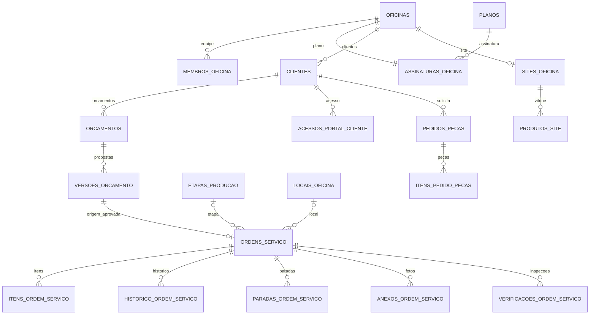

# Modelo do produto: oficinas, OS, producao e portal

Estado atual: nomes da aplicação traduzidos pela quinta migração, aplicada no Supabase. Consulte o [dicionário em português](dicionario-portugues.md) para os campos e parâmetros atuais. Os códigos de situações, eventos e chaves JSON permanecem compatíveis com os dados existentes.

Data: 28/09/2026. Stack: PostgreSQL/Supabase, TypeScript, React Query e Tailwind.

**Estado real (atualizado em 28/09/2026):** projeto remoto `sistema_automotivo` (`hzihxtjirttetnfdujcx`) reativado e banco implantado. O projeto de teste do salao `murakami-homologacao-limpa-20260924` foi pausado conforme pedido do usuario. A fundacao de 27 tabelas ja existia e foi comparada com a migration 1, sem reaplica-la. As migrations 2, 3 e 4 foram executadas pelo SQL Editor. Verificacao remota confirmou 48 tabelas com RLS, tres planos, nove RPCs, view com security_invoker e recipiente privado. Os 60 testes de comportamento foram locais (PGlite); integracao real do aplicativo ainda precisa homologacao. Detalhes em [deployment-2026-09-28.md](deployment-2026-09-28.md).

Este documento substitui o escopo limitado a orcamentos do `database.md`. `schema.sql` e `validate.mjs` antigos continuam como referencia/teste da fundacao; **as cinco migrações são a fonte atual do produto**.

## Decisoes que traduzem o produto em dados

1. Uma oficina e um tenant. Usuarios da equipe podem ter vinculos com varias oficinas; clientes do portal usam vinculo separado.
2. Interface rapida: cadastros pequenos, favoritos, rascunho salvo e uma RPC para converter orcamento aprovado em OS. Nao exigir API de placa.
3. Interface responsiva e visual sao trabalho de React/Tailwind. O banco ajuda com consultas do quadro prontas, indices, revisao contra sobrescrita e operacoes atomicas.
4. Orçamento e proposta publicada continuam separados: editar uma proposta enviada gera outra versao. A OS guarda a versao aprovada de origem.
5. Mapa da oficina: situacao operacional + etapa configuravel + local fisico + responsaveis + motivos de parada + prazo. O quadro e uma view desses dados, nao uma segunda copia dos carros.
6. A assinatura e da oficina. Matriz de recursos por plano, sem nomes de plano espalhados pelo frontend. Nenhum preco, limite comercial ou gateway de cobranca foi inventado.
7. Notinha e nota simples de atendimento, nao nota fiscal e nao comprovante de pagamento automatico.
8. Pedido de peca no portal e uma solicitacao comercial. Nao cobra, nao reserva estoque nem promete disponibilidade.
9. IA produz sugestoes e tem campos de revisao humana; nao aprova orcamentos nem altera historico de servico automaticamente.
10. O n8n continua sendo consumidor de eventos/cliente da API, sem senha administrativa do banco.

## Matriz inicial dos planos

| Recurso | Basico | Intermediario | Completo |
| --- | --- | --- | --- |
| Clientes, veiculos, servicos e produtos | Sim | Sim | Sim |
| Notas simples | Sim | Sim | Sim |
| Orcamentos e aprovacao | Nao | Sim | Sim |
| Ordens de servico e conversao | Nao | Sim | Sim |
| Mapa de producao | Nao | Sim | Sim |
| Fotos e checklists de servico | Nao | Sim | Sim |
| Site e portal do cliente | Nao | Nao | Sim |
| Solicitacao de pecas no portal | Nao | Nao | Sim, se oficina habilitar |
| Automacoes externas e IA | Nao | Nao | Sim |

Interpretacao do pedido inicial, editavel em `recursos_plano`. Downgrade preserva historico; equipe ainda pode ler dados antigos. Novas operacoes avancadas e exposicao premium ficam bloqueadas nos pontos implementados. Validacao de toda futura API e quotas comerciais ainda precisam ser implementadas. Nova oficina recebe registro interno Basico ativo; isso nao contrata/cobra um plano. Billing real deve atualizar `assinaturas_oficina` por backend com webhook verificado e idempotente.

## Inventario: 48 tabelas

### Identidade, cadastros e arquivos (7)

| Tabela | Dados e finalidade |
| --- | --- |
| oficinas | Nome, contato, fuso, endereco, logo e contadores atomicos de OS/notas/orcamentos |
| membros_oficina | Usuario Auth, oficina, owner/manager/staff e ativo |
| clientes | Nome, telefone, email, arquivamento; telefone compartilhado permitido |
| veiculos | Placa, marca/modelo/ano, origem manual/API opcional |
| clientes_veiculos | Relacao cliente/veiculo, contato/proprietario/frota e encerramento |
| itens_catalogo | Servicos e pecas, unidade, preco sugerido, favorito e arquivamento |
| arquivos | Bucket/path, MIME, tamanho, hash e situacao; sem arquivos binarios no PostgreSQL |

### Orcamentos (7)

| Tabela | Dados e finalidade |
| --- | --- |
| orcamentos | Identidade, numero, cliente, veiculo, situacao e versao atual |
| versoes_orcamento | Snapshots, validade, desconto e totais; publicacao congela o conteudo |
| itens_orcamento | Descricao, tipo, unidade, quantidade, preco e total da linha |
| anexos_orcamento | Fotos e legendas da versao publicada |
| documentos_orcamento | PDF e template utilizado |
| tokens_acesso_orcamento | Hash do token, validade, revogacao e referencia cifrada opcional |
| aprovacoes_orcamento | Decisao integral, versao exata, nome declarado, texto e metodo de verificacao |

### Mensagens (4)

`conexoes_whatsapp`, `fila_mensagens`, `tentativas_mensagem`, `eventos_mensagem`: conexao por oficina, fila, tentativas e retornos do provedor. Entrega/lida nao significa aprovacao. Nao conectadas nem ativas nesta entrega.

### Automacoes e auditoria (9)

`eventos_negocio`, `conexoes_integracao`, `assinaturas_eventos`, `entregas_evento`, `tentativas_entrega_evento`, `chaves_api_integracao`, `execucoes_automacao`, `acoes_agendadas`, `registros_auditoria`.

Persistem fatos de negocio, destinatarios, retries, leases, idempotencia, agenda e ator. A mudanca e o evento sao gravados na mesma transacao nas novas RPCs. Dispatchers/cron/n8n ainda precisam ser implementados.

### Planos (4)

| Tabela | Finalidade |
| --- | --- |
| planos | Os tres planos |
| recursos | Os doze grupos de recursos |
| recursos_plano | Quais recursos cada plano habilita |
| assinaturas_oficina | Plano atual, estado, validade e IDs opcionais de billing |

Nao ha escrita direta de assinatura pelo navegador. `private.has_feature` consulta estado e validade, sem confiar em localStorage ou dados de perfil enviados pelo usuario.

### Notas simples (2)

`notas_atendimento`, `itens_nota_atendimento`: cliente/veiculo opcionais, snapshots, itens e totais. Ao emitir, conteudo fica imutavel; cancelar preserva o documento. Funcao de emissao/soma de itens e tela ainda pendentes.

### OS e mapa de producao (9)

| Tabela | Finalidade |
| --- | --- |
| etapas_producao | Etapas configuraveis da oficina, ordem, cor e ativo |
| locais_oficina | Elevadores, boxes, pintura, vagas e coordenadas opcionais do mapa |
| ordens_servico | Ficha principal e referencia de origem ao orcamento aprovado |
| itens_ordem_servico | Pecas/servicos, origem, quantidade, preco e execucao por item |
| responsaveis_ordem_servico | Tecnicos e um responsavel principal |
| historico_ordem_servico | Linha do tempo imutavel; visibilidade explicita para cliente |
| paradas_ordem_servico | Motivos de parada, detalhe, previsao e inicio/fim |
| anexos_ordem_servico | Foto antes/durante/depois/documento; visibilidade controlada |
| verificacoes_ordem_servico | Checklist de entrada, qualidade e entrega |

### Site, portal e pecas (5)

| Tabela | Finalidade |
| --- | --- |
| sites_oficina | Slug, dominio, verificacao de dominio, textos, tema, publicado e switches |
| acessos_portal_cliente | Auth user vinculado a cliente/oficina apos verificacao; revogavel |
| produtos_site | Subconjunto de pecas publicado pela oficina, descricao/preco de vitrine |
| pedidos_pecas | Solicitacao, cliente, autor, situacao, notas separadas e chave idempotente |
| itens_pedido_pecas | Pecas e quantidades solicitadas; cotacao posterior |

### IA (1)

`execucoes_ia`: tarefa, modelo, versao do prompt, situacao, contagem de tokens, resultado e revisao humana. Sem chamadas a modelo, chaves ou cobrancas nesta entrega. Contexto/documentos de busca semantica poderao ser adicionados quando o caso de uso estiver definido.

## Ficha da OS



Diagrama resumido; constraints e relacoes completas estao nas migrations.

Campos projetados:

- Numero, oficina, cliente, veiculo, autor e datas de criacao/alteracao.
- Orcamento e versao aprovada de origem, quando houver; OS direta tambem e representavel.
- Queixa do cliente, diagnostico, observacoes internas e resumo publico separados.
- Quilometragem de entrada/saida, combustivel e pertences.
- Data de entrada, inicio, prazo prometido, conclusao, entrega e cancelamento.
- Motivo de cancelamento, termos de garantia e data limite.
- Status, prioridade, etapa, box e revisao para controle de concorrencia.
- Itens, valores, desconto, tecnicos, pausas, fotos e checklists em tabelas relacionadas.

Nao obrigar todos os campos na primeira tela: apresentar os essenciais e expandir detalhes. A conversao cria OS aberta sem marcar entrada fisica automaticamente. Ao receber o carro, preencher `recebido_em`. Assim o mapa nao mostra carros que ainda nao chegaram como estando no patio.

Uma vaga/elevador comporta uma OS fisicamente presente; a constraint impede ocupacao dupla. Um veiculo tambem nao ocupa duas OS fisicas simultaneas na mesma oficina. Estacionamento coletivo deve ser modelado em vagas individuais ou a regra adaptada explicitamente.

## Estados e pausas

Fluxo operacional implementado:

```text
open -> in_progress -> quality_check -> ready -> delivered
            ^              |             |
            +--------------+-------------+

Qualquer estado aberto pode ser cancelado, com motivo.
```

Etapa e independente: funilaria pode ter Desmontagem, Preparacao, Pintura, Montagem. A etapa nao e o estado financeiro, nem a presenca fisica.

Uma OS `in_progress` pode ter bloqueio `parts` (aguardando peca) ou `approval`. Pode ter mais de um motivo aberto. Resolver preenche `encerrado_em`, preservando os periodos. Nao usar `situacao='parado'` sozinho, pois isso perde o motivo e o ponto de retorno.

`mapa_oficina` retorna prazo, atraso calculado, presenca, etapa/box, responsaveis e bloqueios. Usa `security_invoker=true`, preservando RLS das tabelas. Frontend filtra `presente_na_oficina = true` para o mapa do patio e usa os demais registros em listas de planejamento/historico. `atrasado` usa relogio na consulta; nao fica salvo e desatualizado.

## RPCs implementadas

| Funcao | O que faz |
| --- | --- |
| criar_oficina | Cria oficina e owner, inicializa plano Basico e etapas padrao |
| converter_orcamento_em_os | Exige plano e aprovacao da versao atual; copia itens/valores, gera numero e evento; retry retorna a mesma OS |
| atualizar_mapa_ordem_servico | Exige revisao esperada, valida transicao, etapa/box e bloqueios, grava historico e outbox |
| registrar_parada_os | Abre motivo de parada, incrementa revisao e registra evento |
| resolver_parada_os | Encerra o motivo sem apagar o historico |
| consultar_minhas_ordens_servico | Projecao dos servicos do cliente autenticado e vinculado |
| consultar_meu_historico_os | Somente mensagens explicitamente publicadas ao cliente, sem metadados internos |
| solicitar_pecas | Exige plano completo, portal ativo, vinculo do cliente e oficina permitindo; deduplica pedido e valida produtos |
| consultar_site_publicado | Projecao publica minima de um site habilitado no plano correto |

Exemplo de chamada futura no React Query (usar tipagem gerada do Supabase apos aplicar):

```ts
const { data: workOrderId, error } = await supabase.rpc(
  'convert_quote_to_work_order',
  { p_workshop: workshopId, p_quote: quoteId },
)
if (error) throw error
// Invalidar consultas da oficina: ['work-orders', workshopId] e ['board', workshopId].
```

A chave das queries inclui a oficina. Em troca de sessao/oficina, limpar dados privados do cache pertinente. Clientes offline enviam a revisao que editaram; conflito 40001 exige reconciliar com o servidor. Banco nao implementa sincronizacao offline por si so.

## Seguranca do portal

Auth do cliente nao cria automaticamente permissao por telefone ou placa. O backend precisa verificar identidade e emitir convite/vinculo explicito em `acessos_portal_cliente`; essa jornada ainda sera implementada.

Cliente nao recebe acesso direto a `ordens_servico`, `clientes`, custos, dados de outros clientes, diagnostico interno ou razoes privadas de parada. RPCs retornam apenas campos escolhidos. Fotos privadas precisam de endpoint que confira vinculo e `visivel_ao_cliente` antes de emitir URL temporaria; esse endpoint ainda e necessario.

`dominio_personalizado` e apenas metadado. Publicar DNS/hosting e provar propriedade sao etapas futuras. `tema` deve conter apenas configuracao visual validada, nunca segredo ou HTML arbitrario. Site so aparece se publicado e plano elegivel; politica final de downgrade/comunicacao comercial pode ser ajustada.

## Arquivos

Migration 4 cria `workshop-files`, privado, limite inicial tecnico de 15 MiB por arquivo e MIME para fotos/PDF. Limite e tipos podem mudar conforme testes no celular; HEIC aceito no upload ainda precisa conversao para visualizacao/PDF no backend.

Equipe autenticada le apenas objetos registrados como `ready` de sua oficina. Nao foi liberada escrita direta: upload passa pelo backend autorizado com caminhos novos. Nao salvar objetos privados num recipiente publico. Nenhum arquivo e criado pelas migrations.

## Limites do que esta implementado

- Banco nao gera interface, PDF, site, mensagens ou chamadas de IA sozinho.
- As RPCs antigas de rascunho/publicacao/aprovacao do orcamento, CRUD de cadastros, emissao de nota, OS direta, edicao de itens/checklist/fotos e convite do portal continuam pendentes. Estrutura pronta nao significa endpoints prontos.
- No momento membros ativos podem ler dados internos da propria oficina. Uma matriz mais restrita por funcao (ex.: esconder valores de um tecnico) deve ser definida antes de liberar esses perfis em producao.
- Bloqueios de plano estao implementados nas RPCs novas e em inserts de recursos centrais; novas rotas deverao verificar entitlements tambem. Atualizacoes feitas pelo backend administrativo nunca podem confiar no plano enviado pelo frontend.
- Alteracoes futuras em itens executados/valores aprovados exigem aditivo e historico; nao liberar UPDATE generico pelo navegador.
- Worker de envio, scheduler, n8n, pagamentos SaaS, limites comerciais e rate limiting ainda precisam implementacao.
- Testes locais simulam Auth e metadados do Storage. JWT real, PostgREST, Storage remoto, duas sessoes concorrentes e webhooks reais precisam homologacao.
- Financeiro, estoque, fiscal, comissao e multi-filial nao foram presumidos como requisitos. Adicionar por migrations quando definidos.

## Ordem para aplicar no Supabase

1. Confirmar projeto e ambiente de destino. Em 28/09/2026 o usuario escolheu pausar o teste do salao para liberar a vaga gratuita.
2. Confirmar disponibilidade do banco. O projeto `sistema_automotivo` ja foi retomado.
3. Inspecionar tabelas, funcoes e buckets existentes novamente; a verificacao antiga de banco vazio nao vale depois de uma pausa longa.
4. Se estiver vazio, aplicar em ordem as cinco migrações em `supabase/migrations/`.
5. Se tiver a fundacao antiga aplicada, comparar DDL e registrar baseline corretamente; nao executar a primeira migration novamente nem remover tabelas para forcar passagem.
6. Conferir 48 tabelas com RLS, view do quadro, funcoes e recipiente privado.
7. Executar testes reais com duas oficinas e dois clientes em ambiente de homologacao, sem dados reais.
8. Gerar tipos TypeScript do projeto e conectar o frontend com chave publicavel. Service perfil apenas no servidor.

Arquivos:

1. `20260928000100_quote_foundation.sql`: 27 tabelas de fundacao, RLS e conteudo imutavel.
2. `20260928000200_workshop_product.sql`: 21 tabelas adicionais, planos, defaults, view e controles.
3. `20260928000300_product_operations.sql`: nove RPCs publicas, helpers internos e autorizacao.
4. `20260928000400_storage_and_guards.sql`: recipiente/policy e validacoes de origem de itens e produtos.

Nenhuma migração apaga tabelas ou registros. A quinta renomeia tabelas e campos, recompõe as funções dependentes e remove somente as nove assinaturas antigas das operações públicas, substituídas pelas versões em português. Os cadastros de planos são configurações do produto, sem clientes fictícios. As migrações não devem ser repetidas indiscriminadamente. A aplicação pelo Editor SQL foi registrada em documentos e manifestos locais; o histórico gerenciado pelo Supabase CLI não foi alterado. Antes do primeiro `db push`, conferir o projeto vinculado e conciliar as cinco versões como aplicadas. Não executar a fundação novamente no banco atual.

## Validacao local

```powershell
$dbValidationDir = Join-Path $env:TEMP 'sistema-automotivo-db-validation'
npm.cmd install --prefix $dbValidationDir --no-audit --no-fund --ignore-scripts @electric-sql/pglite
$env:DB_VALIDATION_RUNTIME = Join-Path $dbValidationDir 'node_modules/@electric-sql/pglite/dist/index.js'
node supabase/tests/validate-product.mjs
```

Resultado atualizado: 63 verificações passaram com o esquema em português; outras 115 verificações passaram no cenário de atualização com dados existentes. As verificações cobrem a estrutura, preservação dos dados e os controles de negócio. Resultado anterior: 60 verificacoes passaram, cobrindo DDL, RLS, planos, conversao, totais, concorrencia por revisao, quadro, pausas, historico, Storage simulado, portal, pedidos idempotentes e notas congeladas.

## Referencias verificadas

- [Supabase: views com security_invoker](https://supabase.com/docs/guides/database/views)
- [Supabase: Row Level Security](https://supabase.com/docs/guides/database/postgres/row-level-security)
- [Supabase: Storage e controle de acesso](https://supabase.com/docs/guides/storage/security/access-control)
